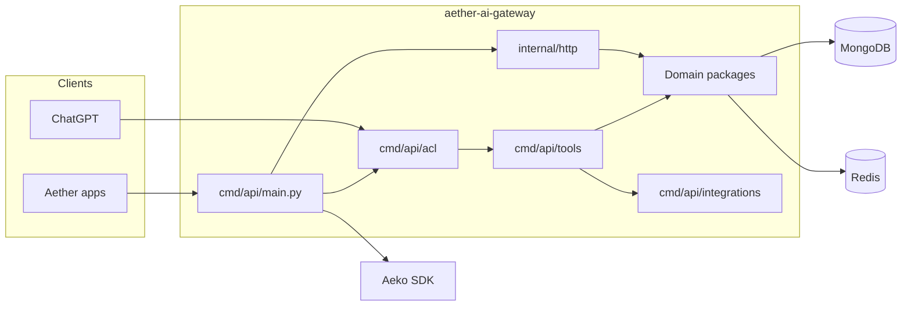

# Aeko Hub (`ms-aeko-hub`)

HTTP API and MCP server that connect [Aether](https://github.com/AetherGases) applications to the AI core ([`aeko-sdk`](https://github.com/AetherGases/aeko-sdk)). It was called *aether-ai-gateway* earlier, and some files still use that name.

Conversations, inventory reports, user memories, ChatGPT tools, and request
and agent metrics all enter through this service. Domain logic stays in
root packages; `cmd/api/main.py` is the only module that imports the Aeko SDK.

[](https://github.com/AetherGases/ms-aeko-hub/actions/workflows/ci.yml)
[](https://www.python.org/downloads/)
[](LICENSE)

| | |
| --- | --- |
| **Layout and practices** | [`PROJECT_STRUCTURE.md`](PROJECT_STRUCTURE.md) |
| **Environment template** | [`.env.example`](.env.example) |
| **Tests** | `python -m pytest -q` |

## Contents

- [Where it fits](#where-it-fits)
- [What it does](#what-it-does)
- [Architecture](#architecture)
- [Repository map](#repository-map)
- [Configure](#configure)
- [Test](#test)
- [Practices](#practices)

## Where it fits

Kong exposes this service under `/hub` and strips the prefix, so `/hub/ai/report` reaches `/ai/report` here. The MCP endpoint is rewritten from `/hub/ai/mcp` to `/ai/mcp/`. Response times are unbounded on purpose: agent runs can take minutes.

| Talks to | Why |
| --- | --- |
| `aeko-sdk` (in process) | Agents, RAG, memory and `AekoInventoryAnalyzer`. Only `cmd/api/main.py` imports it |
| `aether-ms-auth` | Validates the caller's JWT and signs users in for ChatGPT OAuth |
| `aether-ms-inventory` | Reads and creates inventories; the inventory service in turn calls the hub to analyse an uploaded sheet |
| `aether-ms-calculator` | ROI and payback tools (`authentication-key` header, internal route) |
| `aether-ms-cloudinary` | Upload signatures for the ChatGPT inventory upload flow |
| MongoDB, Redis | Users, sessions, plans and metrics; OAuth state, upload tickets and rate limits |
| Gemini, Chroma Cloud, Climatiq, Tavily | Models, gas knowledge base (RAG), emission factors and web search, reached through the SDK and MCP child processes |
| Dynatrace (OTLP) | Optional metrics export |

## What it does

Aether helps industrial teams record greenhouse-gas inventories, read
improvement plans, and ask day-to-day ESG questions. This gateway is the HTTP
and MCP edge in front of that core.

| Surface | Role |
| --- | --- |
| Users and memories | Profile and long-lived user context for the AI gateway |
| Sessions | Conversation list, messages, and inactivity windows |
| Reports | Inventory analysis stored as a textual improvement plan |
| ChatGPT MCP | Tool catalog over `/ai/mcp`, with OAuth sign-in |
| Metrics | HTTP request metrics and SDK run cost |

## Architecture



`cmd/api/main.py` composes the FastAPI app, database, cache, tools, and
lifespan. Handlers never import the SDK. Identity is bound from the
authenticated token, not from the model.

## Repository map

| Path | Owns |
| --- | --- |
| `user`, `session`, `improvement_plan` | Core product domains |
| `oauth`, `upload_ticket` | ChatGPT sign-in and inventory uploads |
| `aeko_metrics`, `hub_metrics` | SDK runs and HTTP metrics |
| `cmd/api/main.py` | Application composition |
| `cmd/api/acl` | MCP auth, ChatGPT catalog, identity |
| `cmd/api/tools` | LangChain tools |
| `cmd/api/integrations` | Inventory, Auth, Profile, Cloudinary, Climatiq, Tavily, Chroma |
| `cmd/memory_generator_worker` | Session memory worker |
| `internal/http` | FastAPI routers |
| `internal/shared` | Logging and request operations |
| `tests/` | Suite, doubles, and `settings.env` |
| `Dockerfile` | `python:3.11-slim` plus Node.js; serves on port 8000 |

Each domain package follows the same shape: `entity.py`, contracts in
`<package>.py`, `service.py`, `constants.py`, then `database/` or `cache/`.
Details are in [`PROJECT_STRUCTURE.md`](PROJECT_STRUCTURE.md).

## Routes

| Route | Purpose |
| --- | --- |
| `GET /ai/user/{id_external_user}` | User profile and memories |
| `GET /ai/sessions/user/{id_external_user}` | Conversation list |
| `GET /ai/session/{id_session}/messages` | Messages of a session |
| `POST /ai/user/session/message` | Send a message to Aeko (the chat entry point) |
| `GET /ai/sessions/cost` | Cost of SDK runs |
| `POST /ai/report`, `GET /ai/report/{id_external_inventory}` | Generate and read an inventory improvement plan |
| `GET`/`POST /ai/user/{id}/inventory-upload/{ticket}/...` | Signed upload and completion for ChatGPT file uploads |
| `/ai/oauth/{authorize,token,revoke}` and `/.well-known/*` | OAuth 2.1 for ChatGPT |
| `/ai/mcp/` | MCP server (tool catalog and widgets for ChatGPT) |

Callers authenticate with the `ms-auth` JWT (`require_ms_auth_principal`); internal callers use `authentication-key`. Swagger UI (`/docs`) is only enabled when the `ENV` variable is `development` (it is not in `.env.example`).

## Run locally

```bash
python -m venv .venv && source .venv/bin/activate
pip install -r requirements.txt
cp .env.example .env            # fill it in completely, see "Configure"
uvicorn cmd.api.main:app --reload --port 8000
```

Needs MongoDB and Redis (the [aether-toolskit](https://github.com/AetherGases/aether-toolskit) starts both), a Gemini key and the URLs of the Java microservices. The Docker image installs Node.js as well, because the MCP child servers (Tavily, MongoDB) run through `npx`. `cmd/memory_generator_worker` is a separate one-shot job: each run builds long-term memories for recently active sessions and exits, so it needs a scheduler (`python -m cmd.memory_generator_worker.main`). The deploy workflow does not schedule it.

## Configure

1. Copy `.env.example` in full. Configurable constants have no Python
   fallback.
2. Each `constants.py` loads the repository-root `.env` without overriding
   variables already in the process.
3. Restart the application after changing settings.

Empty optional model and token settings use SDK defaults.

| Setting | Notes |
| --- | --- |
| Collections in env | JSON for lists, sets, tuples, and dictionaries |
| Log colors | JSON strings with ANSI escapes; `INDENT` keeps quoted spaces |
| `AETHER_WEB_SITE_URL` | URL used by the Tavily site-map tool |
| `AEKO_MCP_WARM_UP` | `false` opens MCP sessions on first use |
| `AEKO_WRITE_FAILURE_MESSAGE` | Required. pt-BR sentence with `{tools}` appended to an answer when a write is lost; startup fails without it |
| Chroma | Tenant, database, API key, and the `gases-info` embedding model |
| Climatiq | Search and estimate over HTTP |
| Finance prompts | Named placeholders such as `{ROI_HORIZON_MONTHS}` |

Calculator function mappings and request field schemas stay in Python.

## Test

```bash
python -m pytest -q
```

The suite loads `tests/settings.env` so local `.env` values do not leak into
constants. SDK and database calls use doubles. MCP warm-up is disabled.

`pytest.ini` turns off the debugging plugin because this repository's `cmd`
package shadows the standard-library module used by `pdb`.

`tests/test_code_quality.py` checks that modules and public functions have
docstrings and that sources have no `#` comments. English wording still needs
human review.

## Deploy

A published **release** triggers `deploy.yml`, which calls the organization's shared EKS workflow ([.github](https://github.com/AetherGases/.github)). The container listens on port 8000 and gets its settings from the `aether-env` Secret. Because constants have no Python fallback, a variable missing from the org config stops the app at startup, so add new ones to `aether-infra` first.

## Practices

Structure, TDD, docstrings, constants, identity, and environment rules live in
**[`PROJECT_STRUCTURE.md`](PROJECT_STRUCTURE.md)**. Follow that file when
adding a package, a handler, or a constant.
