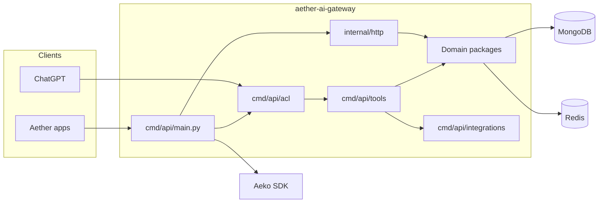

# Aether AI Gateway

HTTP API that connects Aether applications to the AI core.

Conversations, inventory reports, user memories, ChatGPT tools, and request
and agent metrics all enter through this service. Domain logic stays in
root packages; `cmd/api/main.py` is the only module that imports the Aeko SDK.

[](https://github.com/AetherGases/aether-ai-gateway/actions/workflows/ci.yml)
[](https://www.python.org/downloads/)
[](LICENSE)

| | |
| --- | --- |
| **Layout and practices** | [`PROJECT_STRUCTURE.md`](PROJECT_STRUCTURE.md) |
| **Environment template** | [`.env.example`](.env.example) |
| **Tests** | `python -m pytest -q` |

## Contents

- [What it does](#what-it-does)
- [Architecture](#architecture)
- [Repository map](#repository-map)
- [Configure](#configure)
- [Test](#test)
- [Practices](#practices)

## What it does

Aether helps industrial teams record greenhouse-gas inventories, read
improvement plans, and ask day-to-day ESG questions. This gateway is the HTTP
and MCP edge in front of that core.

| Surface | Role |
| --- | --- |
| Users and memories | Profile and long-lived user context for the AI gateway |
| Sessions | Conversation list, messages, and inactivity windows |
| Reports | Inventory analysis stored as a textual improvement plan |
| ChatGPT MCP | Tool catalog over `/ai/mcp`, with OAuth sign-in |
| Metrics | HTTP request metrics and SDK run cost |

## Architecture



`cmd/api/main.py` composes the FastAPI app, database, cache, tools, and
lifespan. Handlers never import the SDK. Identity is bound from the
authenticated token, not from the model.

## Repository map

| Path | Owns |
| --- | --- |
| `user`, `session`, `improvement_plan` | Core product domains |
| `oauth`, `upload_ticket` | ChatGPT sign-in and inventory uploads |
| `aeko_metrics`, `hub_metrics` | SDK runs and HTTP metrics |
| `cmd/api/main.py` | Application composition |
| `cmd/api/acl` | MCP auth, ChatGPT catalog, identity |
| `cmd/api/tools` | LangChain tools |
| `cmd/api/integrations` | Inventory, Auth, Profile, Cloudinary, Climatiq, Tavily, Chroma |
| `cmd/memory_generator_worker` | Session memory worker |
| `internal/http` | FastAPI routers |
| `internal/shared` | Logging and request operations |
| `tests/` | Suite, doubles, and `settings.env` |

Each domain package follows the same shape: `entity.py`, contracts in
`<package>.py`, `service.py`, `constants.py`, then `database/` or `cache/`.
Details are in [`PROJECT_STRUCTURE.md`](PROJECT_STRUCTURE.md).

## Configure

1. Copy `.env.example` in full. Configurable constants have no Python
   fallback.
2. Each `constants.py` loads the repository-root `.env` without overriding
   variables already in the process.
3. Restart the application after changing settings.

Empty optional model and token settings use SDK defaults.

| Setting | Notes |
| --- | --- |
| Collections in env | JSON for lists, sets, tuples, and dictionaries |
| Log colors | JSON strings with ANSI escapes; `INDENT` keeps quoted spaces |
| `AETHER_WEB_SITE_URL` | URL used by the Tavily site-map tool |
| `AEKO_MCP_WARM_UP` | `false` opens MCP sessions on first use |
| `AEKO_WRITE_FAILURE_MESSAGE` | Required. pt-BR sentence with `{tools}` appended to an answer when a write is lost; startup fails without it |
| Chroma | Tenant, database, API key, and the `gases-info` embedding model |
| Climatiq | Search and estimate over HTTP |
| Finance prompts | Named placeholders such as `{ROI_HORIZON_MONTHS}` |

Calculator function mappings and request field schemas stay in Python.

## Test

```bash
python -m pytest -q
```

The suite loads `tests/settings.env` so local `.env` values do not leak into
constants. SDK and database calls use doubles. MCP warm-up is disabled.

`pytest.ini` turns off the debugging plugin because this repository's `cmd`
package shadows the standard-library module used by `pdb`.

`tests/test_code_quality.py` checks that modules and public functions have
docstrings and that sources have no `#` comments. English wording still needs
human review.

## Practices

Structure, TDD, docstrings, constants, identity, and environment rules live in
**[`PROJECT_STRUCTURE.md`](PROJECT_STRUCTURE.md)**. Follow that file when
adding a package, a handler, or a constant.
